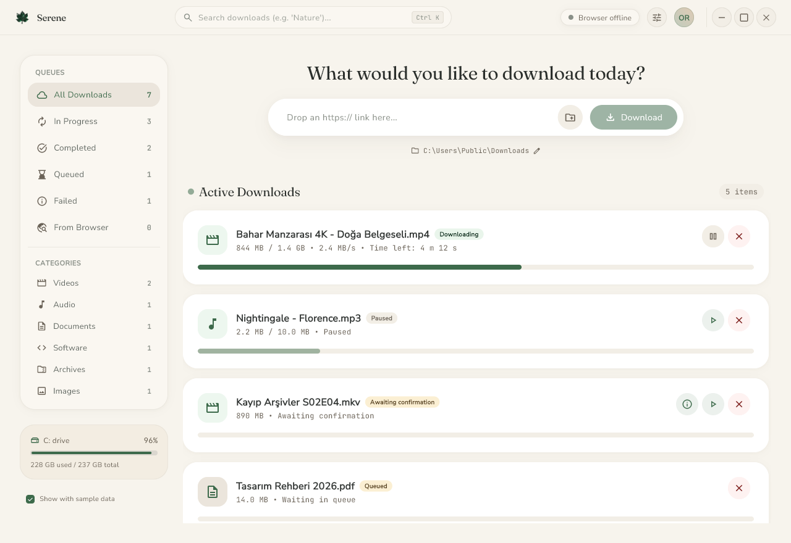

<div align="center">
  
  <h3>Serene</h3>
  <p><b>A calm, tidy download manager for Windows.</b></p>
  <p>
    <a href="https://github.com/izzetwaterson/serene/actions/workflows/ci.yml">
      
    </a>
    <a href="https://github.com/izzetwaterson/serene/releases">
      
    </a>
  </p>
  <p>Windows 10/11 · MIT licensed · <a href="#turkce">Türkçe</a></p>
</div>

---

A download manager for Windows that doesn't try to be fast — it tries to be
**calm**: one window, no clutter, no interruptions. The whole product is a single
executable; the engine runs inside it, so there is nothing else to install and
no background service to keep alive.

## Features

- **Multi-connection downloads** — one file over 8 connections using HTTP
  `Range`, falling back to a single connection when the server doesn't support
  ranges. A segment that stalls is split and re-fetched on a fresh connection.
- **Resumable** — every chunk is written to its own file. Close the app, and it
  picks up where it left off.
- **Stream downloading** — `m3u8` (HLS) and `mpd` (DASH) manifests are parsed,
  fetched, decrypted (AES-128) and merged into one file. When video and audio
  arrive as separate tracks they are muxed with `ffmpeg`, if it is on `PATH`.
- **Browser takeover** — start a download in Firefox or Zen and Serene takes it
  over, carrying the page's `Referer`, `Cookie` and `User-Agent` so gated CDNs
  keep working.
- **Confirmed takeover** — a taken-over download waits for a *Download Details*
  window, where you can change the folder and the file name before it starts.
- **Media capture** — HLS/DASH streams playing on a page appear in a *From
  Browser* panel. Nothing is downloaded without you asking for it.
- **Clipboard suggestions** — a copied link is offered, never started on its own.
- **Queue and categories** — a configurable concurrency limit; the rest wait
  their turn. Categories are inferred from the file extension.
- **Light and dark theme**, **English and Turkish**.

> **The binaries are not code-signed**, so Windows SmartScreen may warn about an
> unknown publisher. That is deliberate: the installer runs as a normal user and
> never asks for administrator rights.

## Install

Download the latest **`Serene-Setup-<version>.exe`** from the
[Releases](https://github.com/izzetwaterson/serene/releases) page and run it.

| Option | Default |
|---|---|
| Install folder | `%LOCALAPPDATA%\Programs\Serene` |
| Start menu shortcut | on |
| Desktop shortcut | on |
| Start when Windows starts | **off** |

To uninstall, use `Settings → Apps → Serene`. Your **download list in
`%APPDATA%\Serene` is preserved.**

### Browser extension (optional)

The extension is published on Firefox Add-ons:

**https://addons.mozilla.org/firefox/addon/serene-download-manager/**

The app offers it once on first launch, and the **Install from Firefox** button
opens that page. The installer never touches the browser bridge — the app
refreshes that registration silently on every launch.

The installer also ships the `extension\` folder next to `Serene.exe`, so you
can load it by hand from `about:debugging#/runtime/this-firefox` if you prefer;
the app's **Open extension folder** button takes you there.

## Requirements

- **Windows 10 or 11** (x64)
- Firefox or Zen — only for the browser integration
- ~40 MB on disk, plus whatever you download

Everything runs on your machine: no account, no telemetry, and no connection
needed beyond the downloads themselves.

## Screenshots



*Queue counts, category filters, progress and disk usage on the left; current
downloads on the right.*

The settings sheet opens over the main window: theme (System / Light / Dark),
language (English / Türkçe), clipboard watching, hide-to-tray, asking before
taking over browser downloads, start on Windows boot, connection count and
concurrent download limit. Screenshots live in `artifacts/` and are captured
with `scripts/capture_window.ps1`.

## How it works

Serene is three pieces, all running on your machine:

```
+--------------------------------------------------+
|  Serene.exe  (single process)                     |
|  |- Interface ........... Flutter (native desktop)|
|  \- Engine .............. Rust, embedded in the UI|
|         segmented | HLS/DASH | queue | bridge      |
+--------------------------------------------------+
     ^                                    ^
     | local TCP bridge (127.0.0.1)      | two-step consent
+-----------+---+            +-----------+--------+
| serene-nmh.exe |           |  "Download Details" |
| (small, fast) |           |  (second process)   |
+---------+-----+           +---------------------+
          | native messaging
+---------+----------+
| Firefox / Zen     |
| + extension       |
+--------------------+
```

**The engine lives inside the interface.** There is no socket between the UI and
the engine; they call each other directly. That is why the download engine needs
no separate installation.

**Only the browser bridge is separate**, because the extension has to launch it
and talk to it. That binary is small and starts fast; if the app isn't running,
it starts it silently.

**The consent window is deliberately a second process.** If the main window
closes, the question is never left unanswered, and two engines never write to
the same task list.

### Where your data lives

| What | Where |
|---|---|
| Task list | `%APPDATA%\Serene\tasks.json` (with a `.bak` sibling) |
| Settings | `%APPDATA%\Serene\settings.json` |
| Captured media | `%APPDATA%\Serene\captures.json` |
| Partial downloads | `.serene/<id>/` inside the download folder |
| Bridge record | `%APPDATA%\Serene\ipc.json` (random port + token) |

The local bridge listens on a random port and requires a random **token** in
every request, so no other program on your machine can drive Serene.

## Limitations

Being straightforward about these:

- **DRM-protected streams cannot be downloaded.** Encrypted variants such as
  `SAMPLE-AES` fail with a clear message. There is no way to decrypt them, and
  none will be added.
- **Magnet / torrent links are rejected.**
- **DASH audio needs ffmpeg to be merged.** When video and audio live in separate
  AdaptationSets both are downloaded; if `ffmpeg` is on `PATH` they are muxed
  into one `.mp4`, otherwise the video stays as the main file and the audio is
  saved next to it as `<name>.audio.m4a`.
- **A stream's total size is unknown until it finishes.** Its progress bar
  advances by segment count.
- **No intra-segment resume for streams.** Completed segments are kept; a
  half-finished one restarts.
- **Categories are a UI filter only.** No folders are created.
- **Many parallel connections** to one server can hit rate limits; lower the
  connection count in settings if that happens.
- **The extension is Firefox-only** (Firefox and Zen). It is on the Firefox
  add-on store; there is no Chromium build.
- **There is no automatic updater yet.** New versions are announced on the
  Releases page.

## Development

<details>
<summary><b>Requirements</b></summary>

- Rust (stable, 1.77+) and Visual Studio Build Tools (C++ workload)
- Flutter 3.47+ with desktop Windows support, Dart 3.13+
- `flutter_rust_bridge_codegen` 2.13.0
- Python 3 with Pillow (icon generation and extension packaging only)
- Node.js (verification scripts and the release pipeline only)
- NSIS 3 (`winget install NSIS.NSIS`) — installer packaging only
</details>

<details>
<summary><b>Building</b></summary>

```cmd
cd flutter_app
flutter pub get
flutter build windows --release
```

The Rust engine is compiled automatically through cargokit. The browser bridge
is built separately:

```cmd
cd native-host
cargo build --release --bin serene-nmh
```

Full release — installer, portable zip and extension package:

```cmd
node scripts\release.mjs
```

Output lands in `dist/`.
</details>

<details>
<summary><b>Tests</b></summary>

```bash
cd core && cargo test               # 87 tests
cd ../native-host && cargo test     # 36 tests
cd ../flutter_app && flutter test   # 61 tests
```

The end-to-end scripts launch the real app and talk to it through the same
bridge the browser extension uses:

```bash
node scripts/check_ffi.mjs             # engine runs inside the single exe
node scripts/check_flutter.mjs         # window, single instance, download, consent
node scripts/check_bridge.mjs          # protocol, event stream, pause/resume
node scripts/check_hls.mjs             # variants, merge, AES-128, DRM rejection
node scripts/check_dash.mjs            # SegmentTemplate, SegmentTimeline
node scripts/check_dynamic.mjs         # splitting a segment that stalls
node scripts/check_dynamic_resume.mjs  # a split after a resume never lands on downloaded bytes
node scripts/check_resilience.mjs      # retry, backoff and non-resumable servers
node scripts/check_captures.mjs        # capture dedup, persistence
node scripts/check_nmh.mjs             # native messaging registration, silent start
node scripts/check_extension.mjs       # extension logic (under a browser mock)
```

> **The scripts must run sequentially** and refuse to start while another
> instance is open.

`scripts/check_manifest.py` checks the extension package, and
`scripts/serve_hls_test.mjs` serves local HLS fixtures for the stream checks.
</details>

<details>
<summary><b>Repository layout</b></summary>

| Path | Contents |
|---|---|
| `core/` | Download engine (Rust, ~5,000 lines) — independent of the UI |
| `flutter_app/lib/` | Interface (Dart/Flutter, ~10,600 lines) |
| `flutter_app/rust/` | FFI layer binding the engine to the UI |
| `native-host/` | Browser bridge binary (Rust, ~570 lines) |
| `extension/` | Firefox extension (JavaScript, ~990 lines) |
| `installer_app/` | Installer and uninstaller UI (Flutter) |
| `installer/` | Single-file NSIS carrier (`bootstrap.nsi`, no UI of its own) |
| `scripts/` | Verification scripts, icon generation, release pipeline |
| `ui/` | Design source and the icon masters |
</details>

## Contributing

Use the **Issues** and **Pull requests** sections on the repository page. The
build, test and verification commands are in the sections above.

## License

MIT — see [`LICENSE`](LICENSE). Third-party components are listed in
[`THIRD_PARTY_LICENSES.md`](THIRD_PARTY_LICENSES.md).

Fonts: Fraunces, Nunito Sans, JetBrains Mono (SIL OFL 1.1) and Material
Symbols (Apache 2.0).

---

<a name="turkce"></a>

## Türkçe

**Serene**, Windows için tasarlanmış sakin bir indirme yöneticisidir. Hızlı
olmaya çalışmaz; sakin olmaya çalışır: tek ekran, sırasız, kesintisiz. Ürünün
tamamı tek bir `.exe` içindedir; motor da onun içinde çalışır, yani ayrıca
kurulacak bir şey ya da arka planda tutulacak bir servis yoktur.

**Kurulum:** [Releases](https://github.com/izzetwaterson/serene/releases)
sayfasından son sürümün `Serene-Setup-<sürüm>.exe` dosyasını indirip çalıştırın;
yönetici şifresi sorulmaz. Tarayıcı eklentisi isteğe bağlıdır; Firefox
Add-ons'ta yayındadır ve uygulama ilk açılışta "Firefox'tan kur" ile sayfasını
açar (paketteki `extension` klasöründen `about:debugging` ile elle de
yüklenebilir).

**Varsayılanlar:** dil İngilizce, tema aydınlık. Ayarlar penceresinden Türkçe'ye
ve karanlık tema üzerinden istediğiniz görünüme geçebilirsiniz.
